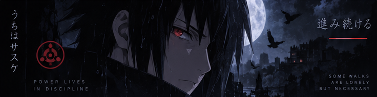
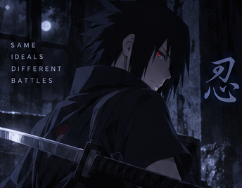
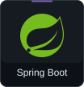
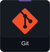

  

# Hi, I'm yergaliuly

**Java · Backend Development**

Building useful software, learning every day.

---

## About Me

I'm a student at **Astana IT University**, focused on Java and backend development.

I learn through practical projects with teammates, improving my understanding of APIs, databases, and software testing.

  

## Tech Stack

  
  
  
  

Java · Spring Boot · PostgreSQL · Git

## Featured Project

### [StudyMate](https://github.com/yergaliuly/StudyMate)

A study app that turns PDF materials into notes and quizzes, with saved results and learning history.

`Java` · `Spring Boot` · `PostgreSQL`

[View on GitHub →](https://github.com/yergaliuly/StudyMate)

---

  

Always learning. Always building.

