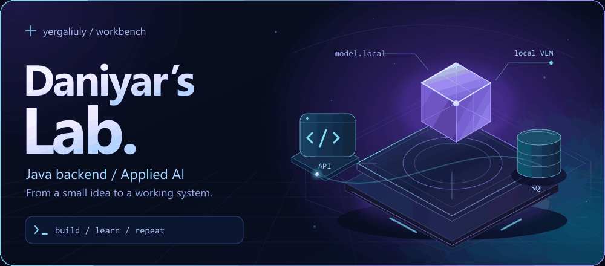
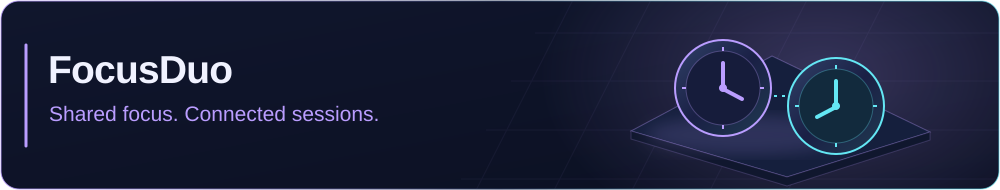
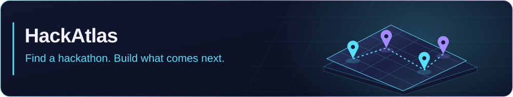
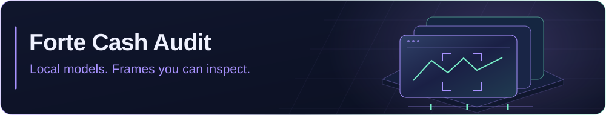
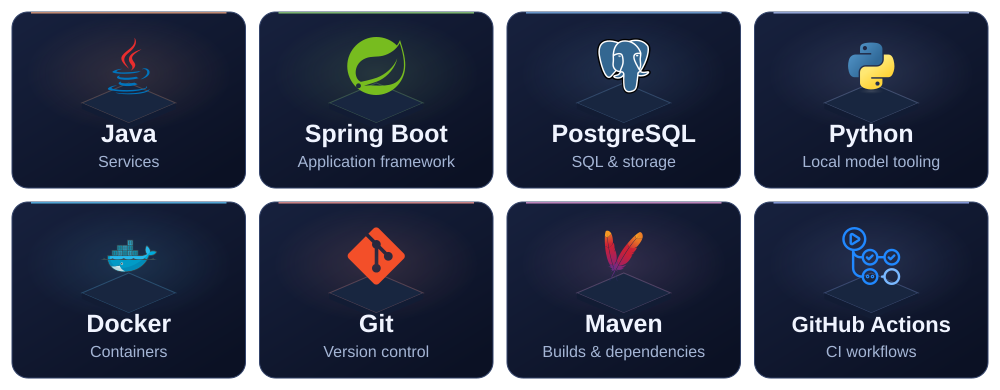
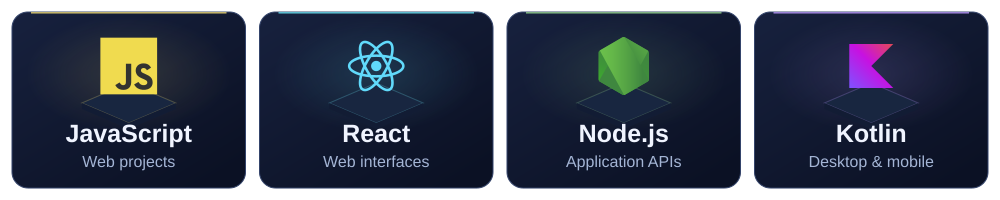

<picture>
  <source media="(prefers-reduced-motion: reduce)" srcset="assets/lab/future/hero.svg">
  
</picture>

# Daniyar Yergalyuly

**Java Backend · Applied AI**

[Explore the builds](#user-content-lab-builds) ·
[Toolkit](#user-content-toolkit) ·
[Open the lab](#user-content-lab-notes) ·
[LinkedIn](https://www.linkedin.com/in/daniyar-yergalyuly-8b6363447/) ·
[KDvibers](https://github.com/KDvibers)

## The person behind the keyboard

```json
{
  "name": "Daniyar Yergalyuly",
  "at": "Astana IT University",
  "focus": "Java backend + AI",
  "building_with": "KDvibers"
}
```

I build APIs, work with databases and run models locally.
I like the part where an idea becomes something we can actually test.

## Lab builds

### [FocusDuo](https://github.com/KDvibers/FocusDuo)

[](https://github.com/KDvibers/FocusDuo)

A desktop app for two-person focus sessions, shared timers and session history.
Built as a team project with a Java backend and a Kotlin/Compose client.

`Java` `Spring Boot` `PostgreSQL` `WebSocket` `Kotlin` `Compose Desktop`

[Windows release 0.1.0](https://github.com/KDvibers/FocusDuo/releases/tag/v0.1.0)

### [HackAtlas](https://github.com/KDvibers/HackAtlas)

[](https://github.com/KDvibers/HackAtlas)

A hackathon discovery app. My responsibility: backend services, infrastructure
and server CI, alongside a teammate building the mobile client.

`Java` `Spring Boot` `PostgreSQL` `Docker` `OpenAPI`

### [Forte Cash Audit](https://github.com/KDvibers/forte-cash-audit)

[](https://github.com/KDvibers/forte-cash-audit)

Local video analysis with timestamps and original evidence frames.
My responsibility: the analyzer, local model runtime and evaluation;
my teammate develops the web interface and application API.

`Python` `Qwen3-VL` `llama.cpp` `PyAV` `Pillow`

### [StudyMate](https://github.com/yergaliuly/StudyMate)

[](https://github.com/yergaliuly/StudyMate)

A team-built study app that turns PDFs into notes and quizzes,
with saved results and learning history.

`Java` `Spring Boot` `PostgreSQL` `React` `Cloudflare R2`

## Toolkit

Tools behind my backend and analyzer work.

<picture>
  <source media="(max-width: 760px)" srcset="assets/lab/future/toolkit-mobile.svg">
  
</picture>

Java · Spring Boot · PostgreSQL · Python · Docker · Git · Maven · GitHub Actions

<details>
<summary>show /toolkit — the full stack and where it fits</summary>

**Backend & data:** Java, Spring Boot, Spring Security, Spring Data JPA,
PostgreSQL, SQL, Flyway, REST APIs and WebSocket.

**Applied AI:** Python, local vision-language models, Qwen3-VL, llama.cpp,
PyAV and Pillow.

**Testing & delivery:** Git, Maven, Docker, GitHub Actions, JUnit,
Testcontainers and OpenAPI. My completed coursework also covers Selenium and Postman.

**Across our team projects:** JavaScript, React, Vite, Node.js, Express,
Prisma, Kotlin and Compose.

<picture>
  <source media="(max-width: 760px)" srcset="assets/lab/future/team-toolkit-mobile.svg">
  
</picture>

</details>

## Lab notes

<details>
<summary>open /lab — a look inside the local video analyzer</summary>

One of the things I work on in **Forte Cash Audit**:

```text
video
  │ PyAV
  ▼
frames + timestamps
  │ Qwen3-VL / llama.cpp
  ▼
local observations
  │ temporal rules
  ▼
evidence + explanation
```

The output is a signal for a person to review. Original frames and timestamps
help us examine both useful detections and mistakes.

[Explore the analyzer](https://github.com/KDvibers/forte-cash-audit/tree/main/analyzer)

</details>

## Proof of work

**HackAlem AI · Participant**<br>
Astana, Kazakhstan · November 1, 2026<br>
[Participation certificate](assets/certificates/hackalem-ai-participation-2026.pdf)

### Selected credentials

- [Software Design and Architecture Specialization](https://www.coursera.org/account/accomplishments/specialization/S0XS0JPD2RP0) — University of Alberta
- [Software Testing and Automation Specialization](https://www.coursera.org/account/accomplishments/specialization/KFJCDHOAMANT) — University of Minnesota
- [First Principles of Computer Vision Specialization](https://www.coursera.org/account/accomplishments/specialization/WWAY980BGGR0) — Columbia University
- [Cloud Computing Specialization](https://www.coursera.org/account/accomplishments/specialization/9ZR7Z0DDU9LS) — University of Illinois Urbana-Champaign
- [IT Fundamentals for Cybersecurity Specialization](https://www.coursera.org/account/accomplishments/specialization/IFQA25WWFQOI) — IBM
- [Google Project Management Professional Certificate](https://www.coursera.org/account/accomplishments/specialization/GX0I0AMYA772) — Google

[Full catalog of completed courses and programs](docs/CERTIFICATIONS.md)

---

Small lab. Real builds. With [KDvibers](https://github.com/KDvibers).
Connect with me on [LinkedIn](https://www.linkedin.com/in/daniyar-yergalyuly-8b6363447/).
