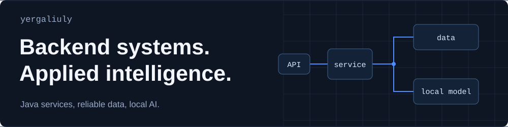

  

# Daniyar Yergalyuly

**Java Backend · Applied AI**

[LinkedIn](https://www.linkedin.com/in/daniyar-yergalyuly-8b6363447/) ·
[KDvibers](https://github.com/KDvibers) ·
[Credentials](docs/CERTIFICATIONS.md)

## About

I'm a student at **Astana IT University**, building backend services and
applied AI tools with teammates at **KDvibers**.

My work spans APIs, databases and local model inference. I care about clear
contracts, useful software and testing what actually happens when systems run.

## Selected projects

### [FocusDuo](https://github.com/KDvibers/FocusDuo)

A desktop app for two-person focus sessions, shared timers and session history.
Built as a team project with a Java backend and a Kotlin/Compose client.

`Java` `Spring Boot` `PostgreSQL` `WebSocket` `Kotlin` `Compose Desktop`

[Windows release 0.1.0](https://github.com/KDvibers/FocusDuo/releases/tag/v0.1.0)

### [HackAtlas](https://github.com/KDvibers/HackAtlas)

A hackathon discovery app. My responsibility: backend services, infrastructure
and server CI, alongside a teammate building the mobile client.

`Java` `Spring Boot` `PostgreSQL` `Docker` `OpenAPI`

### [Forte Cash Audit](https://github.com/KDvibers/forte-cash-audit)

Local video analysis with timestamps and original evidence frames.
My responsibility: the analyzer, local model runtime and evaluation;
my teammate develops the web interface and application API.

`Python` `Qwen3-VL` `llama.cpp` `PyAV` `Pillow`

### [StudyMate](https://github.com/yergaliuly/StudyMate)

A team-built study app that turns PDFs into notes and quizzes,
with saved results and learning history.

`Java` `Spring Boot` `PostgreSQL` `React` `Cloudflare R2`

## Technology toolkit

**Backend & data** 
Java, Spring Boot, Spring Security, Spring Data JPA, PostgreSQL, SQL,
Flyway, REST APIs and WebSocket.

**Applied AI** 
Python, local vision-language models, Qwen3-VL, llama.cpp, PyAV and Pillow.

**Testing & delivery** 
Git, Maven, Docker, GitHub Actions, JUnit, Testcontainers and OpenAPI.
My completed coursework also covers Selenium and Postman.

**Across our team projects** 
JavaScript, React, Vite, Node.js, Express, Prisma, Kotlin and Compose.

## Selected credentials

- [Software Design and Architecture Specialization](https://www.coursera.org/account/accomplishments/specialization/S0XS0JPD2RP0) — University of Alberta
- [Software Testing and Automation Specialization](https://www.coursera.org/account/accomplishments/specialization/KFJCDHOAMANT) — University of Minnesota
- [First Principles of Computer Vision Specialization](https://www.coursera.org/account/accomplishments/specialization/WWAY980BGGR0) — Columbia University
- [Cloud Computing Specialization](https://www.coursera.org/account/accomplishments/specialization/9ZR7Z0DDU9LS) — University of Illinois Urbana-Champaign
- [IT Fundamentals for Cybersecurity Specialization](https://www.coursera.org/account/accomplishments/specialization/IFQA25WWFQOI) — IBM
- [Google Project Management Professional Certificate](https://www.coursera.org/account/accomplishments/specialization/GX0I0AMYA772) — Google

[Full catalog of completed courses and programs](docs/CERTIFICATIONS.md)

## Hackathons

**HackAlem AI · Participant** 
Astana, Kazakhstan · November 1, 2026 
[Participation certificate](assets/certificates/hackalem-ai-participation-2026.pdf)

---

Building with [KDvibers](https://github.com/KDvibers).
Connect with me on [LinkedIn](https://www.linkedin.com/in/daniyar-yergalyuly-8b6363447/).
